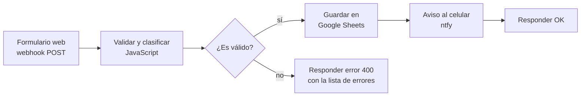

# Automatización de contactos web con n8n

Flujo de [n8n](https://n8n.io) que recibe los formularios de contacto de un sitio web, los valida, los clasifica, los guarda en Google Sheets y avisa al celular en el momento.

Lo armé para el formulario de mi portfolio ([fbrizuela.com](https://fbrizuela.com)), pero sirve para cualquier sitio que pueda hacer un `POST`.

## Qué hace



1. **Formulario web:** un webhook recibe `nombre`, `email`, `telefono` y `mensaje` en JSON.
2. **Validar y clasificar** (nodo de código en JavaScript):
   - Normaliza los datos (recorta espacios, pasa el email a minúsculas, deja solo los dígitos del teléfono).
   - Valida que haya nombre, un email o teléfono válido y un mensaje.
   - Clasifica la consulta por palabras clave en *Presupuesto*, *Reparación*, *Laboral* o *Consulta general*.
   - Si el mensaje dice "urgente", "hoy" o "lo antes posible", le pone **prioridad alta**.
3. **Guardar en Google Sheets:** agrega una fila con fecha, datos, tipo y prioridad. Usa una cuenta de servicio de Google Cloud, así que no depende de un inicio de sesión personal y funciona igual en cualquier servidor.
4. **Aviso al celular:** manda una notificación push con [ntfy](https://ntfy.sh). Los contactos urgentes llegan con prioridad alta y otro ícono.
5. **Respuesta:** el formulario recibe `{"ok": true, "tipo": "..."}`, o un `400` con los errores para mostrarlos al usuario.

## Ejemplo

```bash
curl -X POST http://localhost:5678/webhook/contacto \
  -H "Content-Type: application/json" \
  -d '{"nombre":"Ana","email":"ana@ejemplo.com","mensaje":"Hola, la notebook no prende, es urgente"}'
```

Respuesta:

```json
{"ok": true, "tipo": "Reparación"}
```

En la planilla aparece una fila nueva y en el celular llega el aviso **"Nuevo contacto: Reparación"** con prioridad alta.

Con datos inválidos:

```json
{"ok": false, "errores": ["Falta el nombre", "Falta un email o teléfono válido", "El mensaje está vacío"]}
```

## Cómo levantarlo

Requisitos: Node.js 20 o 22.

```powershell
npm install
copy config.env.example datos\config.env   # completar NTFY_TOPIC y SHEET_ID
.\iniciar.ps1 import:workflow --input=flujos\contactos.json
.\iniciar.ps1 start
```

El editor queda en http://localhost:5678.

Para Google Sheets:

1. En Google Cloud, crear un proyecto, habilitar la **Google Sheets API** y crear una **cuenta de servicio** con una clave JSON.
2. Compartir la planilla con el mail de la cuenta de servicio como **Editor**. La primera fila tiene que tener las columnas `Fecha, Nombre, Email, Teléfono, Tipo, Prioridad, Mensaje`.
3. En n8n, crear una credencial **Google Service Account** con el mail y la clave privada, y elegirla en el nodo "Guardar en Google Sheets".

Para los avisos, instalar la app ntfy en el celular y suscribirse al mismo tema que figura en `NTFY_TOPIC`.

## Estructura

| Archivo | Qué es |
|---|---|
| `flujos/contactos.json` | El flujo exportado de n8n |
| `iniciar.ps1` | Arranca n8n con la configuración de `datos/config.env` |
| `config.env.example` | Plantilla de configuración |
| `datos/` | Base de datos de n8n, credenciales y configuración privada (no se sube al repo) |

## Tecnologías

n8n · JavaScript · Google Sheets API (cuenta de servicio) · ntfy · webhooks y APIs REST
